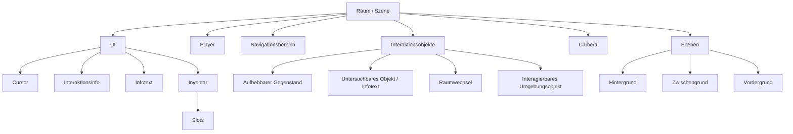
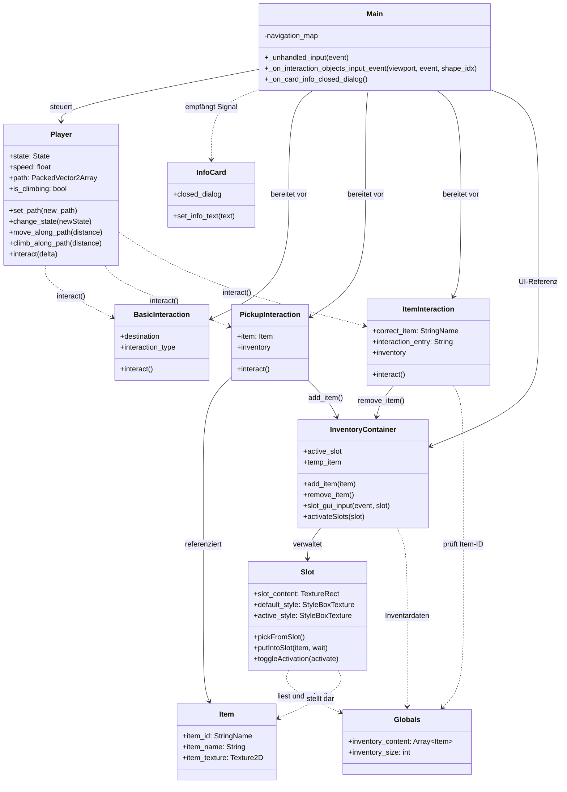
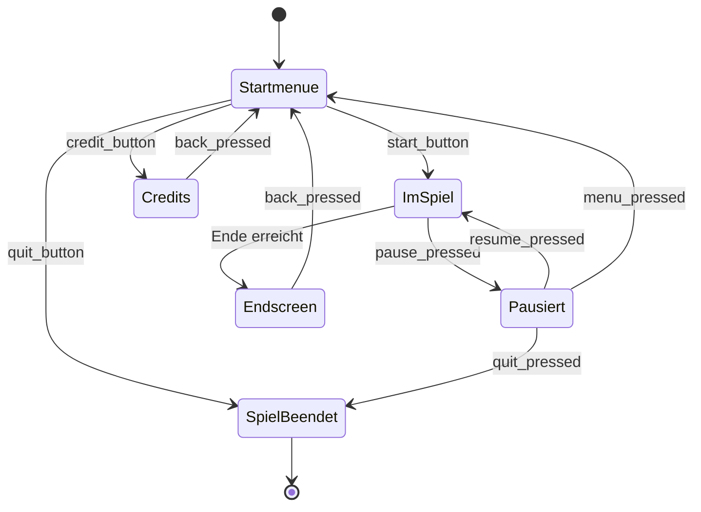
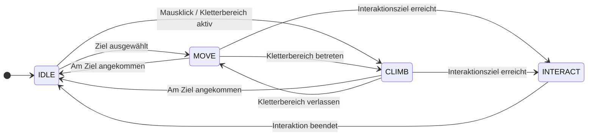

# Technical Design Document – Der Einsame Astronaut

**Projekt:** Der Einsame Astronaut  
**Dokument:** V6a – Technical Design Document  
**Stand:** 22.11.2026  
**Status:** Lebendes Dokument  
**Verantwortungsbereich:** Technical Director

> **Dokumentationsstand:** Die beschriebenen Systeme beruhen auf dem aktuellen Prototyp und den vorgesehenen Spielabläufen. Geplante, noch nicht implementierte Funktionen werden ausdrücklich gekennzeichnet.

## 1. Rahmen

| Eigenschaft | Festlegung |
|---|---|
| Genre | 2D-Science-Fiction-Point-and-Click-Adventure |
| Engine | Godot 4.7.2 (angegebene Projektversion) |
| Programmiersprache | GDScript |
| Zielplattform | PC |
| Eingabegerät | Maus |
| Spielmodus | Einzelspieler |

Ich entwickle *Der Einsame Astronaut* in Godot mit GDScript. Die Steuerung erfolgt über die Maus. Damit werden die Spielfigur navigiert, Objekte untersucht und Gegenstände aufgenommen, im Inventar kombiniert beziehungsweise auf die Umgebung angewendet.

## 2. Budgets

| Kriterium | Geplantes Ziel |
|---|---:|
| Zielbildrate | 30 FPS |
| Frame-Budget | 33,33 ms pro Bild |
| Maximaler Arbeitsspeicherverbrauch | 512 MB |
| Maximale Build-Größe | 200 MB |

Ich strebe eine stabile Bildrate von 30 FPS an. Daraus ergibt sich ein rechnerisches Frame-Budget von rund 33,33 ms. Der Arbeitsspeicherverbrauch des laufenden Spiels soll maximal 512 MB und die exportierte Build-Größe maximal 200 MB betragen.

**Alle Werte sind geplante Zielbudgets und keine bereits gemessenen Ergebnisse.** Sie werden anhand späterer Tests mit einem exportierten Build überprüft und gegebenenfalls angepasst.

## 3. Architekturübersicht

Die Spielwelt ist in Räume beziehungsweise Szenen gegliedert. Jeder Raum verwendet das Skript `main.gd` zur Verwaltung seiner raumspezifischen Abläufe. Darüber werden insbesondere die begehbaren beziehungsweise erreichbaren Bereiche über die Navigation sowie die verfügbaren Interaktionsobjekte und deren Interaktionen koordiniert. Eine Raum-Szene enthält die Spielfigur, Navigation, interagierbare Objekte, Kamera, Darstellungsebenen sowie die Benutzeroberfläche. Die Interaktionsobjekte umfassen aufhebbare Gegenstände, untersuchbare Objekte, Raumwechsel und Objekte, auf die Inventargegenstände angewendet werden können.

### Szenenstruktur und Komponenten

*Abbildung 1: Szenenstruktur und Komponentenübersicht. Das Diagramm zeigt den grundlegenden Aufbau eines Raums mit Spielfigur, Navigation, Interaktionsobjekten, Kamera, Darstellungsebenen und Benutzeroberfläche. Die untergeordneten Komponenten veranschaulichen insbesondere die verschiedenen Interaktionsarten und den Aufbau des Inventars.*

## 4. Kernklassen

Die zentralen Skripte trennen Spielsteuerung, Bewegung, Gegenstandsdaten und Inventarinteraktionen. `Item` und `Slot` besitzen im Code ausdrücklich deklarierte Klassennamen. Die Namen der übrigen Skripte im Diagramm sind zur Dokumentation verwendete Bezeichnungen.

### Klassendiagramm

*Abbildung 2: Vereinfachtes Klassendiagramm aus dem vorliegenden GDScript-Code. `BasicInteraction`, `PickupInteraction` und `ItemInteraction` sind beschreibende Namen für die jeweiligen Skripte, keine im Code definierten `class_name`-Typen. Die dargestellten Methoden von `InfoCard` sind anhand der Aufrufe und Signalverbindungen beschrieben; deren vollständiges Skript liegt hier nicht vor.*

| Klasse / Skript | Verantwortung |
|---|---|
| `Main` (`main.gd`) | Ist das zentrale Skript jedes Raums. Es verwaltet die raumspezifische Navigation (wo sich die Spielfigur hinbewegen kann), verarbeitet Mausklicks und koordiniert die im jeweiligen Raum verfügbaren Interaktionsobjekte sowie ihre Aktionen. |
| `Player` | Verwaltet Bewegung, Klettern und Interaktionszustände der Spielfigur. |
| `Item` | Definiert Gegenstände als Godot-Resources mit ID, Name und Textur. |
| `Globals` | Hält den globalen Inventarinhalt und die Inventargröße bereit. |
| `InventoryContainer` | Bedient das Inventar, verwaltet die Auswahl von Slots und das Hinzufügen beziehungsweise Entfernen von Gegenständen. |
| `Slot` | Zeigt einen Inventarplatz an, aktualisiert dessen Inhalt und markiert die Auswahl. |
| Interaktionsskripte | Untersuchen, Aufheben sowie Anwenden eines Items auf ein Umgebungsobjekt. |
| `InfoCard` | Zeigt Informationstexte an und meldet das Schließen des Textfeldes. |

Das Klassendiagramm konzentriert sich auf die projektspezifischen Abhängigkeiten. Die Vererbung von Godot-Basisklassen und die vollständige Node-Hierarchie sind aus Gründen der Lesbarkeit nicht zusätzlich abgebildet.

## 5. Spielablauf und Zustände

### Spielzustandsdiagramm

*Abbildung 3: Spielzustandsdiagramm. Das Diagramm stellt den geplanten Ablauf zwischen Startmenü, laufendem Spiel, Pause, Credits und Endscreen dar. Die beschrifteten Übergänge zeigen, durch welche Eingaben oder Ereignisse ein Zustandswechsel ausgelöst wird; diese Funktionen sind nicht alle bereits im Prototyp implementiert.*

### Zustandsdiagramm der Spielfigur

*Abbildung 4: Spielerzustandsdiagramm. Dargestellt sind die vier Zustände `IDLE`, `MOVE`, `CLIMB` und `INTERACT` der Spielfigur. Die Übergänge verdeutlichen, wie Mausklicks, das Erreichen eines Ziels, das Betreten oder Verlassen eines Kletterbereichs sowie abgeschlossene Interaktionen den aktuellen Zustand verändern.*

## 6. Kommunikation

Ich verwende Godots vordefinierte Signals und das eigene Signal `closed_dialog`, um Eingaben, Kollisionen und abgeschlossene Animationen zu verarbeiten. Signals erlauben ereignisbasierte Reaktionen, statt Zustände permanent abfragen zu müssen.

| Skript / Empfänger | Signal und Sender | Ereignis / Reaktion |
|---|---|---|
| `main.gd` | `input_event` – `InteractionObjects` (`Area2D`) | Mausklick auf ein Objekt; entsprechende Interaktion vorbereiten und ausführen. |
| `main.gd` | `mouse_exited` – `InteractionObjects` | Maus verlässt Interaktionsbereich; Cursor zurücksetzen. |
| `main.gd` | `closed_dialog` – `InfoCard` | Infocard geschlossen; Spielerzustand auf `IDLE` setzen. |
| `main.gd` | `body_entered`, `body_exited` – Kletterbereich (`Area2D`) | Kletterbereich betreten oder verlassen; Bewegungszustand anpassen. |
| `infocard.gd` | `animation_finished` – `AnimatedSprite2D` | Text nach beendeter Öffnungsanimation anzeigen. |
| `infocard.gd` | `pressed` – Schließen-Button | Infocard schließen und `closed_dialog` auslösen. |
| `interaction_box_message.gd` | `animation_finished` – `AnimationPlayer` | Text nach `fade_in` anzeigen und anschließend ausblenden. |
| `backpack.gd` | `toggled` – Backpack-Button | Inventarsymbol zwischen offen und geschlossen umschalten. |
| `inventory_container.gd` | `pressed` – Inventar-Button | Inventar ein- beziehungsweise ausblenden. |
| `inventory_container.gd` | `pressed` – linker/rechter Pfeil-Button | Inventar horizontal scrollen. |

**Warum Signals?** Die vordefinierten Signals verbinden Node-Ereignisse gezielt mit den entsprechenden Reaktionen. Das eigene `closed_dialog`-Signal entkoppelt die Infocard von der Zustandsverwaltung der Spielfigur: Die Infocard meldet lediglich das Schließen, während `main.gd` den Zustand ändert. Andere Abläufe werden weiterhin zentral über `main.gd` koordiniert; nicht sämtliche Komponenten sind bereits lose gekoppelt.

## 7. Daten

**Konfigurationsdaten.** Ich speichere Konfigurationswerte in GDScript und in exportierten Inspector-Eigenschaften. Gegenstände sind `Item`-Resources mit `item_id`, `item_name` und `item_texture`. Weitere Einstellungen umfassen beispielsweise die Bewegungsgeschwindigkeit, Inventargröße und Eigenschaften von Interaktionsobjekten.

**Laufzeitdaten.** Der aktuelle Inventarinhalt wird im globalen Skript `Globals` als `Array[Item]` verwaltet; die Inventargröße beträgt im gezeigten Code sechs Plätze. Player-Zustand, Position, Navigationspfad und laufende Interaktionen werden zur Laufzeit in den jeweiligen Komponenten gehalten.

**Speicherstände.** Ein dauerhaftes Speichersystem ist derzeit nicht implementiert. Ob und in welcher Form es später ergänzt wird, ist **noch nicht entschieden**. Aktuelle Laufzeitdaten bleiben beim Beenden des Spiels nicht dauerhaft erhalten.

## 8. Drittanbieter

**Bibliotheken und Plugins.** Bisher setze ich keine zusätzlichen externen Bibliotheken oder Plugins ein; die Spiellogik verwendet Godots integrierte Funktionen und eigene GDScript-Skripte.

**Externe Platzhalter.** Im Prototyp verwende ich vorübergehend Assets aus einer Tutorialreihe des YouTube-Kanals **kilogalaxia2035**. Die Projektdateien werden über Google Drive bereitgestellt; als Drive-Eigentümer ist **flygamesstudio2017** angegeben.

- Tutorial: https://www.youtube.com/watch?v=4QSbr9MfJRY
- Playlist: https://www.youtube.com/playlist?list=PLUO8yoWlZ_ayjV1XioVXt47q6b5nKpKPi
- Lizenzstatus: **Nicht geklärt**, da keine ausdrücklichen Lizenzbedingungen gefunden wurden.

**Eigene Platzhalter.** Zusätzlich verwende ich selbst erstellte Assets aus früheren Spielprojekten. Die derzeitigen Platzhalter sollen im weiteren Entwicklungsverlauf durch speziell für *Der Einsame Astronaut* erstellte Grafiken ersetzt werden. Vor einer Weitergabe lizenzrechtlich ungeklärter Fremdassets müssen die Nutzungsrechte geklärt oder die betreffenden Dateien ersetzt werden.

## 9. Konventionen

**Coding-Standard.** Ich orientiere mich an den Konventionen von Godot/GDScript: Einrückungen mit Tabs, `snake_case` für Variablen, Funktionen und Signals, `PascalCase` für Klassen sowie Großbuchstaben mit Unterstrichen für Konstanten. Dateinamen werden vorzugsweise kleingeschrieben und durch Unterstriche getrennt. Kommentare erläutern komplexere Abläufe und technische Entscheidungen.

Diese Regeln sind die **angestrebten Konventionen**; bestehende Skripte enthalten teilweise noch abweichende Namen wie `activateSlots()` oder `pickFromSlot()`.

**Projektorganisation und Asset-Pipeline.** Skripte, Szenen und Assets werden getrennt organisiert. Pixel-Art-Assets werden in **Aseprite** erstellt, als PNG-Dateien beziehungsweise Spritesheets exportiert und anschließend in Godot als Texturen oder Animationen eingebunden.

**Entwicklungsworkflow.** Weitere Regeln für Projektstruktur, Asset-Import, Versionsverwaltung, Tests und Builds sollen in `PIPELINE.md` dokumentiert werden. Diese Datei ist zum aktuellen Stand noch nicht vollständig ausgearbeitet.

## 10. Entscheidungen

Wesentliche technische Entscheidungen halte ich in Architecture Decision Records (ADRs) fest.

| ADR | Entscheidung | Status |
|---|---|---|
| **ADR-0001** | Godot 4 mit GDScript statt Unity als Engine | Akzeptiert |
| **ADR-0002** | Verwendung von Godot-Resources für das Item-System | Akzeptiert |

**ADR-0001 – Engine:** Ich verwende Godot aufgrund meiner vorhandenen Kenntnisse, der für mich zugänglicheren Bedienung und der Flexibilität für eigene Gameplay-Systeme. Die Entscheidung wurde zusätzlich anhand einer gewichteten Matrix mit Unity verglichen.

**ADR-0002 – Item-Daten:** Ich verwende Godots `Resource`-System, um Items mit einer eindeutigen ID, einem Namen und einer Textur zu definieren. Dadurch lassen sich Gegenstandsdaten unabhängig von einzelnen Interaktionsskripten wiederverwenden. Nachteile sind die zusätzlich erforderliche Interaktionslogik und das Risiko unbeabsichtigter Änderungen an gemeinsam referenzierten Resources.

